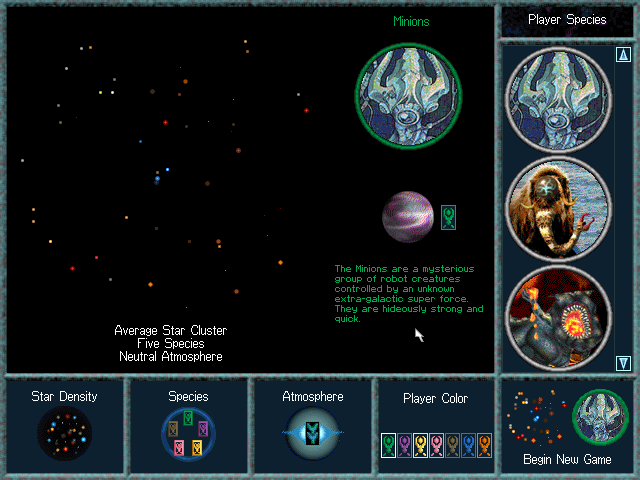
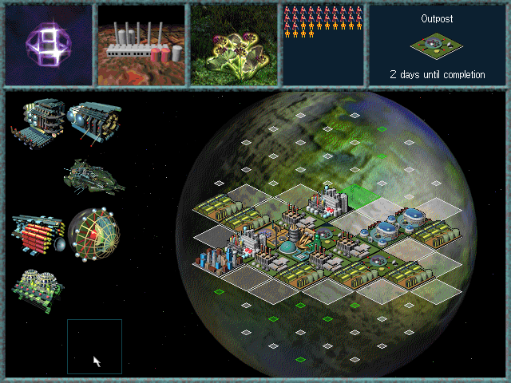
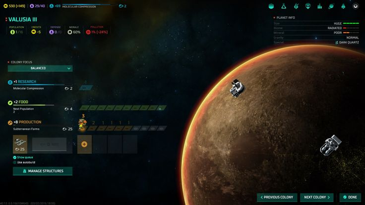
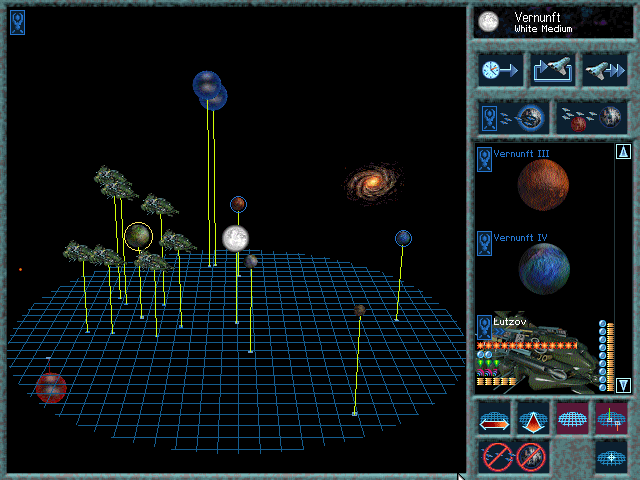

I'm building a remake of a game that fascinated me from the first time I saw it with its unique look, feel and sound: Ascendancy. 

What I think stands up even today is the art direction, the decision to show you how a planet feels rather than turning it into a spreadsheet. If it's flourishing, there's a lush growth in the prosperity section.

As a comparasion, here's Master of Orion from 2016, much more spreadsheet-y:

The design choices of the game were great throughout, but limited by the resources of the time. The amibituous 3D galaxy and rotating star-systems feel hard to use these days with the on-screen camera controls. 

Worse, the reviewers of the time were not wrong that ['the level of micromanagement is simply ridiculous'](https://gamefaqs.gamespot.com/pc/575213-ascendancy/reviews/104028#:~:text=The%20level%20of%20micromanagement%20is%20simply%20ridiculous). Replaying it as an adult, I also realise why the AI was considered famously ['terrible'](https://gamefaqs.gamespot.com/pc/575213-ascendancy/reviews/104028#:~:text=the%20AI%20is%2C%20well%2C%20terrible), even with the (excellently named) Antagonizer patch.

Therefore I felt the base game and feel deserves a reimagining with modern rendering. So I'm building a homage to Ascendancy - using the same rules, and taking the art direction from the original as far as I can. I want this to feel like Ascendancy, while looking better and being more fun to play.

Here's where I am so far: 

I'm not hand-coding this, which is helping me stay at the design level. I'm a month in so far, with a largely asynchronous process of a batch of prompts before and after work, with the agent working autonomously. I've been using a Codex $200/month subscription, and thanks to the release of Terra and some resets, have been able to keep it running pretty well constantly. It has been interesting to have to lean so far into automony, and I'll share some of the techniques I've been using to avoid needing close supervision.

This is intended as a present to fellow fans, and to share the magic of the game's artistic vision with people who've not tried it. I've no plans to monetise. I'm paying forward the gift the original team gave me by putting this wonderfully weird game out into the world.

