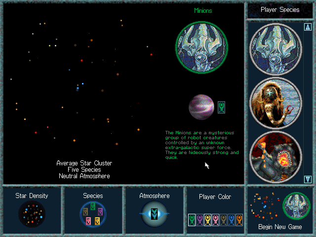
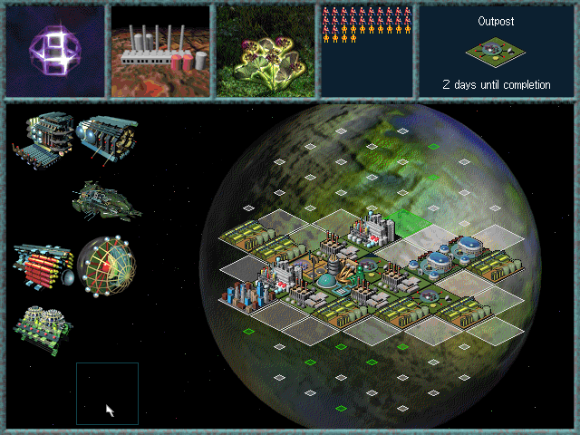
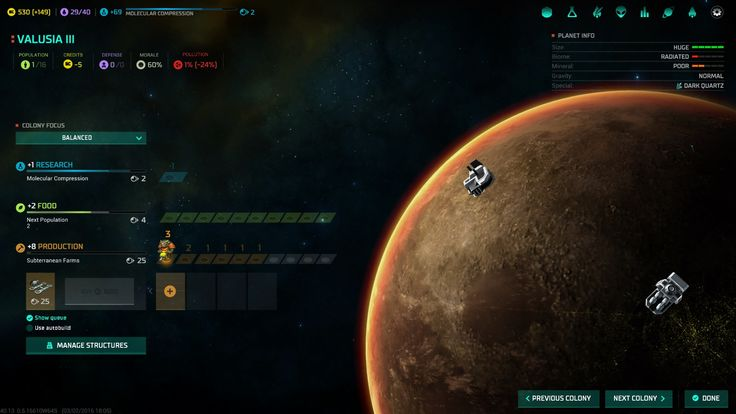
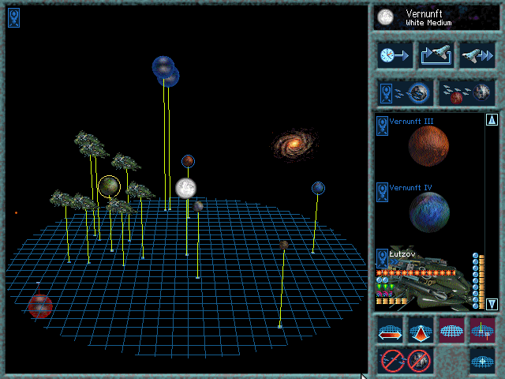
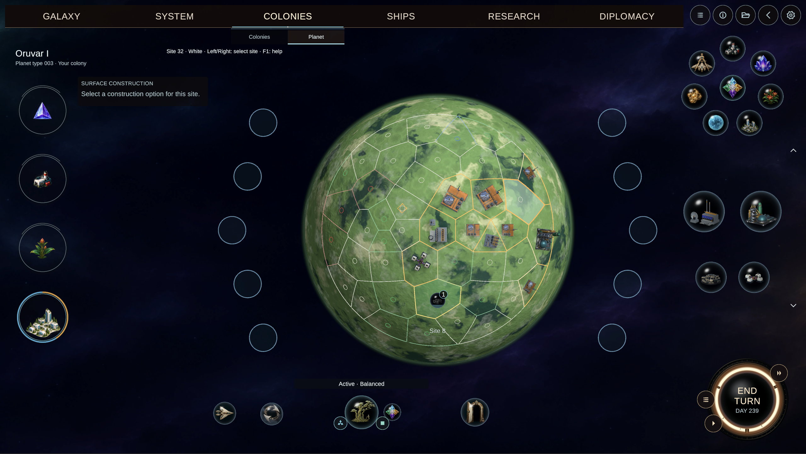
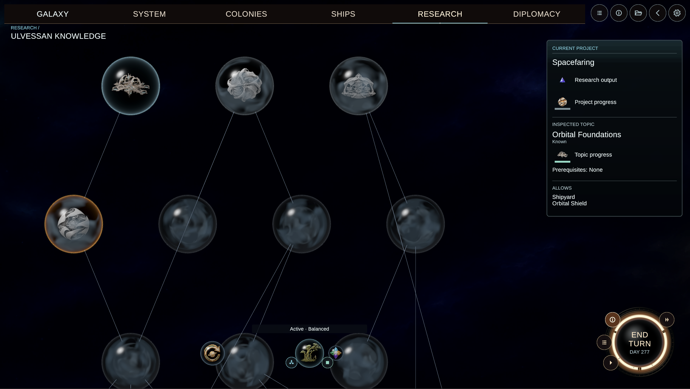

I'm building a remake of a game that fascinated me from the first time I experienced its unique look, feel and [sound](https://www.youtube.com/watch?v=uVqS7uDv_OE): Ascendancy. 

What I think stands up even today, over 30 years since its release, is the art direction and atmosphere. For example, it makes you feel the state of your planets visually, rather than turning it into a spreadsheet. If a planet is flourishing, you see it immediately from the lush growth; you can see from the glow if it's a scientific powerhouse:

As a comparison, here's Master of Orion from 2016, much more spreadsheety: "+2 food". Collapsing everything to figures nudges the player towards feeling the game is just a numerical puzzle to crack, breaking the immersion:

The design choices of the game were great throughout, but limited by the resources of the time. The ambitious 3D galaxy and rotating star-systems feel hard to use these days, with their on-screen camera controls: 

Worse, this reviewer was not wrong that ['the level of micromanagement is simply ridiculous'](https://gamefaqs.gamespot.com/pc/575213-ascendancy/reviews/104028#:~:text=The%20level%20of%20micromanagement%20is%20simply%20ridiculous). As the game progresses, each game turn involves an ever-growing burden of rote building decisions. Replaying it as an adult, I also realise why the AI was considered famously ['terrible'](https://gamefaqs.gamespot.com/pc/575213-ascendancy/reviews/104028#:~:text=the%20AI%20is%2C%20well%2C%20terrible), even with the Antagonizer patch (great name).

Therefore I felt the game's vision deserved a reimagining with modern rendering and playability tweaks. So I'm building a homage to Ascendancy - using the same rules, and taking the art direction from the original as far as I can. I want this to feel like Ascendancy, while looking better and being more fun to play.

Here's a taste of where I've got so far: 

I'm not hand-coding this, which is helping me stay at the design level. I'm a month in so far, with a largely asynchronous process of a batch of prompts before and after work, with the agent working autonomously. I've been using a Codex $200/month subscription, and thanks to the release of Terra and some resets, have been able to keep it running pretty well constantly. It has been interesting to have to lean so far into autonomy, and I'll share some of the techniques I've been using to avoid needing close supervision.

I've no plans to monetise. I'll release it as a gift to fellow fans, and to share the magic of the original's artistic vision with people who've not experienced it.

